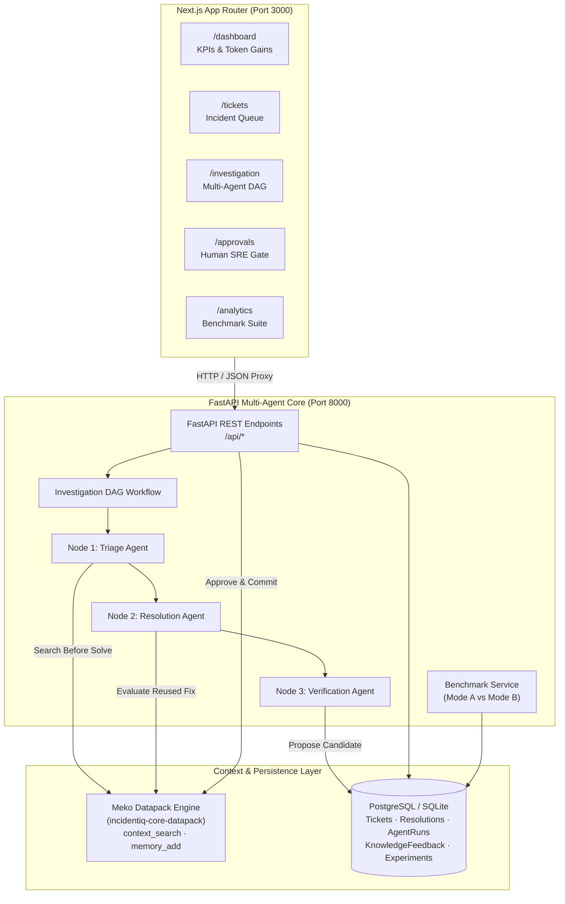
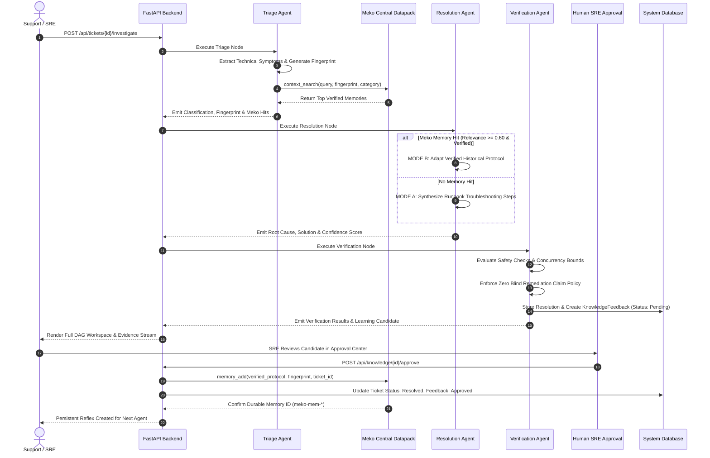

# INCIDENTIQ — System Architecture Specification

## 1. High-Level Architecture Overview

IncidentIQ is built as a modular multi-agent platform comprising a high-performance **FastAPI** backend, a **Next.js 14** App Router frontend, a persistent **SQLAlchemy** transactional store, and a centralized **Meko Context Engine** datapack.

---

## 2. Multi-Agent Orchestration DAG

The investigation process follows a deterministic sequential DAG where intermediate results and decision evidence are logged into immutable `AgentRun` records:

---

## 3. Normalized Incident Fingerprinting

To enable cross-ticket knowledge discovery across disparate wording, the `TicketService` deterministically extracts technical error signatures:

$$\text{Fingerprint} = \text{Category} : \text{PrimarySymptom} : \text{MD5}(\text{Category} : \text{SortedSymptoms})[0:8]$$

### Symptoms Hierarchy
1. **Domain-Specific Technical Patterns:** `pool_exhaustion`, `stripe_gateway_timeout`, `rate_limited`, `auth_token_drift`, `memory_oom`, `cors_origin_mismatch`, `kafka_partition_lag`.
2. **HTTP Telemetry Codes:** `HTTP_504`, `HTTP_500`, `HTTP_429`, `HTTP_401`, `HTTP_403`.
3. **Lexical Stems:** Filtered technical nouns.

When recurring incidents share the `Category` and `PrimarySymptom` (e.g. `database_connection_failures:pool_exhaustion`), Meko's relevance score receives a domain boost, triggering Mode B reuse even if the ticket descriptions differ entirely in prose.

---

## 4. Database Schema Specification

- **`tickets`:** Primary support incident records (`id`, `title`, `description`, `category`, `severity`, `fingerprint`, `status`, `symptoms`, `created_at`, `resolved_at`).
- **`resolutions`:** Agent resolution outcomes (`id`, `ticket_id`, `root_cause`, `recommended_solution`, `confidence_score`, `verification_status`, `verification_evidence`, `reused_from_memory_id`, `approved_by`).
- **`agent_runs`:** Challenge 07 Audit trail per node (`id`, `ticket_id`, `agent_name`, `execution_status`, `input_tokens`, `output_tokens`, `execution_time_ms`, `evidence`, `started_at`, `completed_at`).
- **`knowledge_feedback`:** Human SRE oversight candidates (`id`, `ticket_id`, `resolution_id`, `proposed_learning`, `approval_status`, `reviewer`, `meko_memory_id`, `reviewed_at`).
- **`experiments`:** Challenge 08 Benchmark comparisons (`id`, `ticket_id`, `execution_mode`, `total_tokens`, `execution_time_ms`, `model_calls`, `quality_score`, `knowledge_reused`).
